
<picture><source media="(prefers-color-scheme: dark)" srcset="assets/hero-dark.svg"></picture>

<b>I build the controls for AI agents.</b> 
Co-founder of <b>Deimos AI LLC</b>. Agents never sleep and never tire, so I make sure a person stays in charge of every act that matters: seen, approved, stoppable and provable. 
<a href="https://clockford.com"><b>Clockford</b></a> (patent pending): see, approve and stop your AI agents from your phone, whichever company built them. Private beta 10 Nov 2026 ·
<a href="https://ratchetgate.com"><b>Ratchet</b></a>: a retried charge, deploy or email happens at most once ·
<a href="https://github.com/thearchitect0x-glitch/crimp"><b>Crimp</b></a>: open-source decision gate for AI agents (patent pending) ·
<a href="https://marklode.com"><b>Marklode</b></a>: startup due diligence before the pitch, in 24–72 h ·
<a href="https://deimoscore.com"><b>M.A.X</b></a>: offline-first behavioral analysis for litigation teams. 
AI agent security · agent governance · human-in-the-loop approval · MCP · systems architecture · startup due diligence · previously co-producer, Gaming Wall St (HBO Max, 2022)

  
  
  

<picture><source media="(prefers-color-scheme: dark)" srcset="assets/divider-1-dark.svg"></picture><a href="https://clockford.com"></a><a href="https://ratchetgate.com"></a><a href="https://github.com/thearchitect0x-glitch/crimp"></a><a href="https://marklode.com"></a><a href="https://deimoscore.com"></a><picture><source media="(prefers-color-scheme: dark)" srcset="assets/divider-2-dark.svg"></picture>


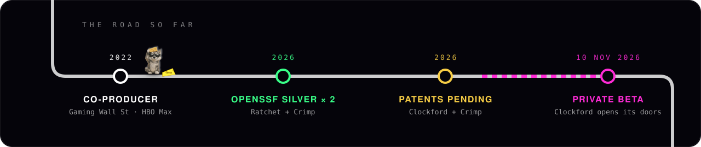<picture><source media="(prefers-color-scheme: dark)" srcset="assets/divider-3-dark.svg"></picture><a href="https://github.com/thearchitect0x-glitch/thearchitect0x-glitch/issues/new?template=found-the-wolf.yml"><picture><source media="(prefers-color-scheme: dark)" srcset="assets/footer-dark.svg">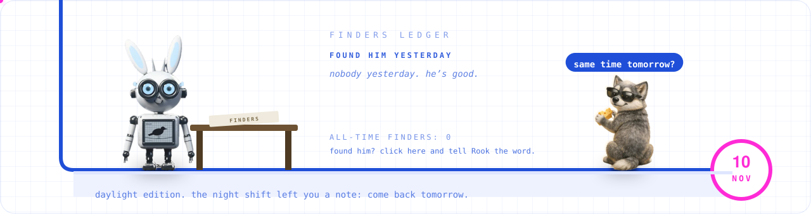</picture></a>

<b>the stack</b>


a tiny wolf hides somewhere on this page every day. find him, read the word on his cheese, tell Rook.

