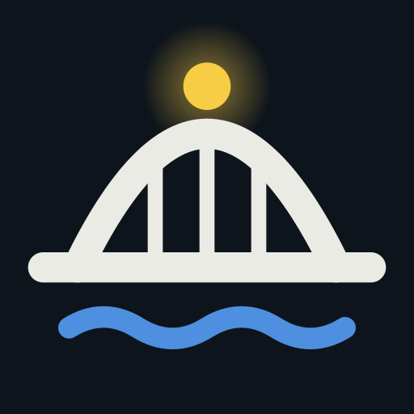
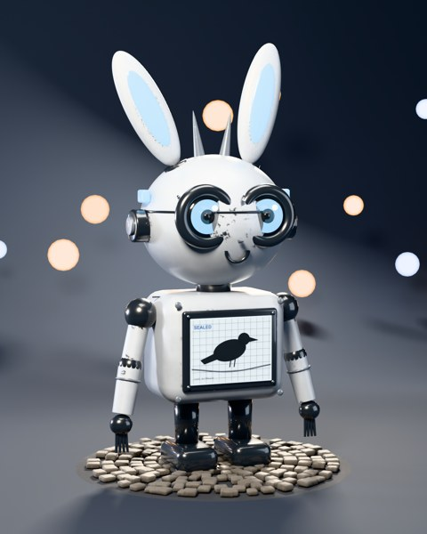
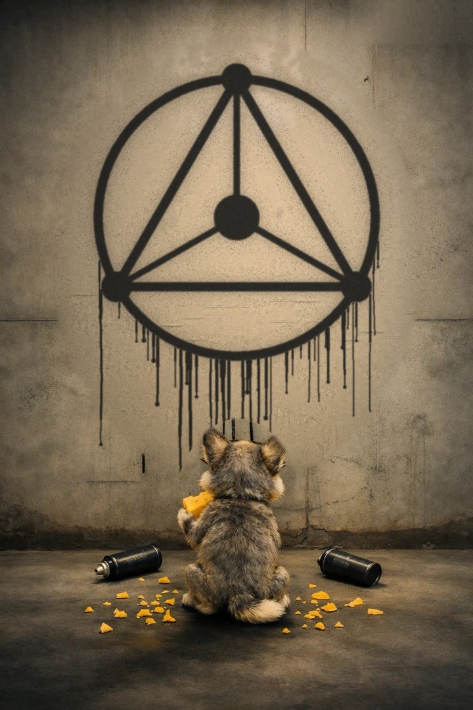

  

  
  
  
  
  

<!--wolf:top-->

 <i>you found the wolf. tell no one.</i>

<!--/wolf:top-->

> AI agents never sleep, never tire and can copy themselves. Most people ask how smart they'll get. **I ask what happens to every system they touch, then I build the answer.**

## ⟁ the system map

| | what it does | where |
|---|---|---|
|  **Clockford** | See, approve and stop your AI agents from your phone, whichever company built them. Private beta 10 Nov. | `patent pending` |
| 🟢 **Ratchet** | The effect gate for AI agents: a retried charge, deploy or email happens at most once. | [ratchetgate.com](https://ratchetgate.com) · OpenSSF Silver |
| 🟣 **Crimp** | An open-source decision gate: the agent submits its rule and facts, not a conclusion, and the decision withdraws itself when a fact stops holding. | [repo](https://github.com/thearchitect0x-glitch/crimp) · `patent pending` · OpenSSF Silver |
| 🔵 **Marklode** | Startup diligence before the pitch: competitors, overlapping patents, the three strongest attacks, a verdict. | [marklode.com](https://marklode.com) |
| 🟠 **M.A.X** | Offline-first behavioral analysis, read against each person's own baseline. | [deimoscore.com](https://deimoscore.com) |

<!--wolf:mid--><!--/wolf:mid-->

## &gt;_ the terminal

## how I see it

When I look at a problem, I see the whole system laid out in front of me, lit up like a map: every connection, every place it could break. It feels like magic. Then I sit with the hunch until the pattern clicks, and attack my own ideas harder than anyone else will. Everything here faced an adversary before it faced a customer.

<table>
<tr>
<td width="62%">

**Four rules run through all of it**

1. People stay in charge of what matters.
2. Assume something is already inside.
3. If it matters, make it provable.
4. Bend, don't break.

**Meet Rook.** He lives in Clockford. You'll meet him properly at the beta.

</td>
<td width="38%" align="center"></td>
</tr>
</table>

<!--wolf:low--><!--/wolf:low-->

---

  
   <i>the wolf found the wall.</i>
    
  
   DEIMOS AI LLC · built at 3 a.m., on purpose

